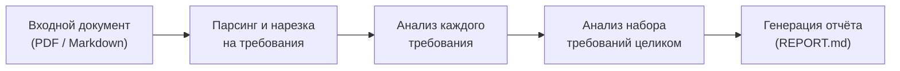

# BCC-HUB x MNU FinTech Hackathon: Агент проверки требований

> **Официальный репозиторий технического задания для участников хакатона.**  
> Организаторы: [BCC-HUB](https://bcchub.kz/) (Банк ЦентрКредит) совместно с [Maqsut Narikbayev University (MNU)](https://bcchubagents.mnu.kz/), при поддержке shai.pro, Alpha.Edu и mnu.ai.club.

---

## 1. Задача

Разработать **ИИ-агента (AI Requirements Validator Agent)**, который проводит **статическую проверку готового документа с требованиями (ТЗ)**:
1. Автоматически читает и разбирает входной документ со спецификацией.
2. Нарезает документ на атомарные требования и структурирует их.
3. Оценивает каждое требование по отдельности и весь набор требований в целом по строгим критериям качества спецификаций.
4. Формирует подробный, объективный отчёт аудита с точными ссылками на текст документа и практическими рекомендациями по исправлению.

> ⚠️ **Важно:** Проверка здесь — это **ревью требований до начала разработки**, а не запуск автотестов готовой программы. Агент ищет системные дефекты формулировок: двусмысленность, нетестируемость, логические и архитектурные противоречия, пропуски пограничных кейсов, антипаттерны и лишние проектные решения.

---

## 2. Материалы и тестовые документы

В директории [`docs/`](./docs/) представлены реальные примеры финтех-спецификаций, на которых команды могут тестировать и отлаживать своего агента:

1. **[`docs/01_card_expenses_notification.md`](./docs/01_card_expenses_notification.md)** — Спецификация функционала «Уведомление о расходах по карте: месячный порог» (включает BPMN, функциональные требования, Sequence, требования к данным, чеклист ревью).
2. **[`docs/02_card_expenses_rest_api.md`](./docs/02_card_expenses_rest_api.md)** — Спецификация интеграционного REST API метода `/alerts/saveLimit` (содержит параметры запроса/ответа, статус-коды и логику сохранения).
3. **[`docs/CRITERIA_GUIDE.md`](./docs/CRITERIA_GUIDE.md)** — Подробное руководство по критериям качества требований по стандартам ISO/IEC/IEEE 29148 и IEEE 830.

*Примечание:* Документы намеренно содержат как корректно составленные требования, так и типовые дефекты аналитики (неоднозначности, конфликты типов данных, использование метода GET для мутаций, пустые разделы). Задача агента — найти их все.

---

## 3. Что необходимо сдать участникам

До **27 ноября 2026 года (до 23:59)** команды сдают:

1. **Публичный репозиторий на GitHub / GitLab:**
   * Исходный код агента (Python, TypeScript, Go или любой другой язык по выбору команды).
   * Файл зависимостей (`requirements.txt`, `pyproject.toml`, `package.json` и т.д.).
   * Понятный `README.md` с пошаговой инструкцией: как настроить окружение, как получить и куда положить API-ключ, какой **одной командой** запустить прогон агента на тестовом документе.
   * Файл `.env.example` в корне проекта (секреты и API-ключи ни в коем случае не коммитятся!).
2. **Отчёт о проверке (Markdown / PDF):**
   * Файл отчёта, **сгенерированный именно вашим агентом** по переданным документам. Ручные отчёты без прогона агента дисквалифицируются.
   * Структура отчёта должна строго соответствовать шаблону [`templates/REPORT_TEMPLATE.md`](./templates/REPORT_TEMPLATE.md).
3. **Ссылка на видео-демонстрацию работы:**
   * Короткая запись экрана (3–5 минут, Loom / YouTube / Google Drive), показывающая запуск агента из консоли или веб-интерфейса, процесс анализа и получение итогового отчёта.

---

## 4. Как устроен прогон агента

Прогон должен выполняться воспроизводимо одной командой:
```bash
# Пример вызова для CLI-агента:
python main.py --input docs/01_card_expenses_notification.md --output report_01.md

# Либо с поддержкой PDF:
python main.py --input spec.pdf --output report.md
```

### Этапы работы агента:


1. **Загрузка и парсинг:** Агент принимает путь к файлу требований (обязательна поддержка PDF и/или Markdown/текстовых форматов).
2. **Атомизация требований:** Агент извлекает требования, присваивает им идентификаторы (`REQ-01`, `REQ-02`...), сохраняет точные цитаты из источника и привязку к разделам.
3. **Оценка единичных требований:** Проверка каждого требования по критериям (Полнота, Однозначность, Проверяемость, Реализуемость, Необходимость).
4. **Системный анализ набора требований:** Поиск кросс-противоречий между разделами/документами, оценка архитектурных стандартов и рисков.
5. **Запись отчёта:** Формирование и сохранение итогового файла отчёта.

---

## 5. Выбор LLM-модели

Команды вольны использовать любую языковую модель:
* **Рекомендуемый бесплатный вариант:** [Google AI Studio](https://aistudio.google.com/) (Gemini 1.5 Flash / Gemini 1.5 Pro). Бесплатного тарифа (Free tier) с запасом хватает для всех этапов хакатона.
* **Другие провайдеры:** OpenAI (GPT-4o / GPT-4o-mini), Anthropic (Claude 3.5 Sonnet), DeepSeek, Mistral.
* **Локальные модели:** Ollama / vLLM (Llama 3, Qwen 2.5, DeepSeek-R1).

> 💡 Платный ключ для сдачи **не требуется**. Жюри проверяет работу агента на бесплатной модели или на собственных ключах по вашей инструкции в README.

---

## 6. Критерии качества требований

Агент базирует свою оценку на международных стандартах **ISO/IEC/IEEE 29148:2018** (п. 5.2.5 и 5.2.6) и **IEEE Std 830-1998** (п. 4.3):

1. **Полнота (Completeness):** Описан ли сценарий до конца? Не забыты ли пограничные случаи, обработка ошибок, параметры API?
2. **Однозначность (Unambiguity):** Исключено ли двоякое толкование? Выявлены ли субъективные фразы (например, *«отчёт должен загружаться быстро»* — что такое «быстро», 1 секунда или 5 минут? Требуется ли синхронность?).
3. **Непротиворечивость (Consistency):** Нет ли внутренних противоречий между требованиями или единицами измерения (тиыны vs тенге).
4. **Тестируемость / Проверяемость (Verifiability):** Можно ли написать понятный тест-кейс, проверяющий выполнение требования?
5. **Осуществимость (Feasibility):** Реализуемо ли требование технически (например, недопустимость мутаций через HTTP GET)?
6. **Необходимость (Necessity):** Несёт ли требование измеримую бизнес-пользу или это избыточная «хотелка»?

Полный справочник критериев см. в файле [docs/CRITERIA_GUIDE.md](./docs/CRITERIA_GUIDE.md).

---

## 7. Требования к итоговому отчёту

* **Язык отчёта:** Русский.
* **Формат:** Файл Markdown (`.md`) или PDF.
* **Обязательные разделы:**
  1. **Паспорт прогона:** имя документа, дата/время, название модели, версия/коммит агента.
  2. **Таблица нарезки требований:** `ID в отчёте` — `ID в документе` — `Раздел` — `Точная цитата`.
  3. **Проверка каждого требования:** оценка по критериям, выявленные дефекты, рекомендации по исправлению.
  4. **Проверка набора требований целиком:** системные противоречия, архитектурные несоответствия, незаполненные разделы.
  5. **Сводка:** общее количество требований, распределение дефектов по критичности (CRITICAL, MAJOR, MINOR).
  6. **Итоговый вердикт:** готов ли документ к передаче в разработку/тестирование, и топ первоочередных блокеров для исправления.
* **Принцип доказательности:** Никаких абстрактных формулировок. Каждое замечание обязательно цитирует фрагмент исходного документа.

Готовый эталонный шаблон: [`templates/REPORT_TEMPLATE.md`](./templates/REPORT_TEMPLATE.md).

---

## 8. Критерии оценки жюри

Решения команд оцениваются по 4 равнозначным критериям (по 25% каждый, суммарно 100%):

* **25% — Уточнение требований (Requirements Insight):** Глубина анализа, способность агента выявлять скрытые пограничные кейсы, неточности и пробелы в ТЗ.
* **25% — Архитектура агента (Agent Architecture):** Чистота кода, архитектурные решения (RAG, цепочки промптов, валидация JSON/схем, обработка ошибок LLM, модульность).
* **25% — Бизнес-ценность и качество продукта (Product Value):** Удобство запуска, наглядность и практическая полезность генерируемого отчёта для аналитиков и инженеров.
* **25% — Презентация и защита (Presentation & Demo):** Качество демонстрационного видео, полнота документации в репозитории и защита на финале.

---

## 9. График хакатона

| Дата | Этап |
| :--- | :--- |
| **25 ноября, 15:00** | **Kickoff и старт разработки** (Вебинар «От запроса к спецификации», публикация ТЗ). |
| **25–27 ноября** | **Build Phase:** разработка агента. |
| **27 ноября, 23:59** | **Дедлайн сдачи работ:** фиксация репозиториев и отчётов. |
| **28 ноября – 1 декабря** | **Оценка жюри** и отбор 12 команд-финалистов. |
| **4 декабря 2026** | **Гранд-финал и награждение** (очно в Maqsut Narikbayev University, Астана, и онлайн). |

---

## 10. Контакты и поддержка

* Официальный сайт хакатона: [bcchubagents.mnu.kz](https://bcchubagents.mnu.kz/)
* Организаторы: [BCC-HUB](https://bcchub.kz/)
* Чат участников и Q&A: Ссылка направлена в письме зарегистрированным командам.
